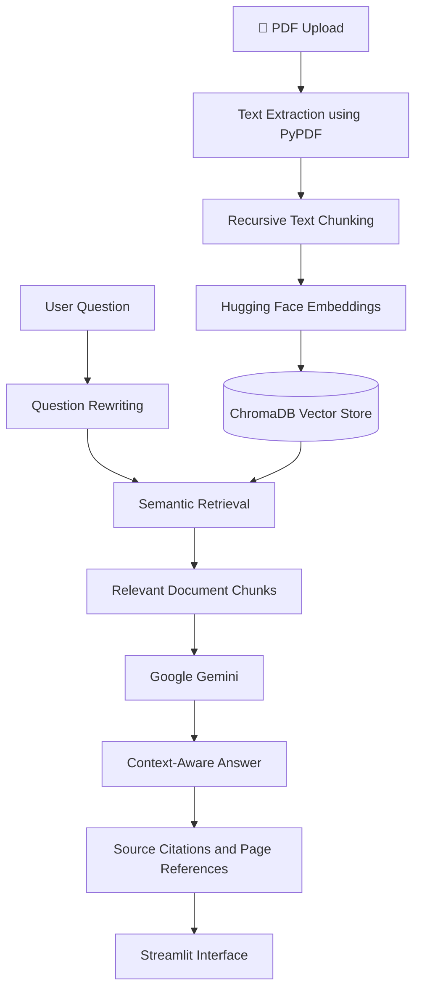
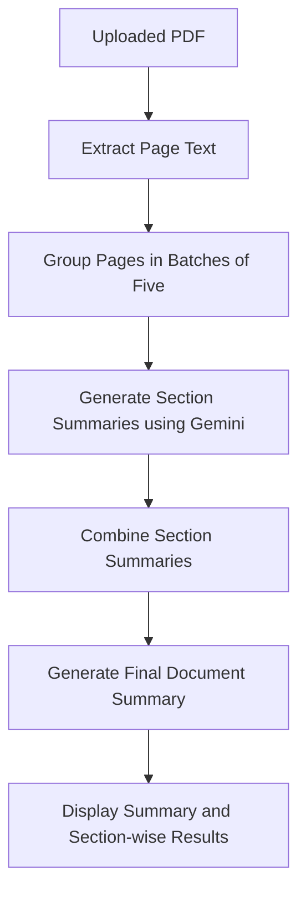

# 📚 DocuMind — AI-Powered PDF Question Answering Assistant

  <b>Transform static PDF documents into an interactive AI-powered knowledge assistant.</b>

  
  
  
  

---

## 🌐 Live Application

### **Try DocuMind:** [https://documinds.streamlit.app/](https://documinds.streamlit.app/)

DocuMind is an AI-powered PDF assistant that allows users to upload PDF documents, ask questions in natural language, and receive intelligent, context-aware answers grounded in the content of their documents.

Built using **Retrieval-Augmented Generation (RAG)**, the application combines semantic search, vector embeddings, persistent vector storage, and Google's Gemini model to make document understanding more efficient and interactive.

---

## ✨ Key Features

| Feature | Description |
|---|---|
| 📄 Multiple PDF Uploads | Upload and process multiple PDF documents in one workspace. |
| 📝 Text Extraction | Extract text from PDF pages using PyPDF while preserving page metadata. |
| 🧩 Intelligent Chunking | Split extracted text into overlapping chunks for effective retrieval. |
| 🧠 Semantic Embeddings | Convert text chunks into vector representations using Sentence Transformers. |
| 🗄️ Vector Database | Store document embeddings and metadata using ChromaDB. |
| 🔍 Semantic Search | Retrieve relevant document passages based on the user's question. |
| 🤖 AI Question Answering | Generate context-aware answers using Google Gemini. |
| 📚 Source Citations | Display source document names, page numbers, and retrieved text passages. |
| 💬 Conversational Memory | Support follow-up questions using recent conversation history and question rewriting. |
| 📖 Full Document Summarization | Generate a comprehensive summary of an entire PDF. |
| 📑 Section-wise Summaries | Summarize document sections in groups of five pages and combine them into a final summary. |
| 🎯 Document-Specific Retrieval | Restrict retrieval to the currently selected PDF. |

---

## 🧠 System Architecture

DocuMind uses a Retrieval-Augmented Generation pipeline to provide answers based on uploaded documents instead of relying only on the language model's general knowledge.

### RAG Workflow

### Document Summarization Workflow

---

## ⚙️ Technology Stack

| Category | Technology | Purpose |
|---|---|---|
| Programming Language | Python | Core application development |
| Frontend | Streamlit | Interactive web application |
| LLM | Google Gemini 3.5 Flash Lite | Question answering and summarization |
| AI Architecture | Retrieval-Augmented Generation | Grounded document question answering |
| Embedding Model | all-MiniLM-L6-v2 | Semantic text embeddings |
| Embedding Framework | Sentence Transformers | Generate vector representations |
| Vector Database | ChromaDB | Persistent vector storage and similarity search |
| PDF Processing | PyPDF | Extract text from PDF documents |
| AI Framework | LangChain | Document splitting and embedding integrations |
| Environment Management | Python Virtual Environment | Dependency isolation |
| Testing | Pytest | Automated testing |
| Deployment | Streamlit Community Cloud | Public application hosting |

---

## 🔄 How DocuMind Works

### 1. Document Ingestion
- Users upload one or multiple PDF files.
- PyPDF extracts text from individual pages.
- Page numbers and source filenames are retained as metadata.

### 2. Text Processing
- Extracted text is divided into smaller chunks.
- Recursive Character Text Splitter is used.
- Chunk size: **1000 characters**
- Chunk overlap: **200 characters**

This helps preserve context between neighboring chunks.

### 3. Embedding Generation
- The `sentence-transformers/all-MiniLM-L6-v2` model generates 