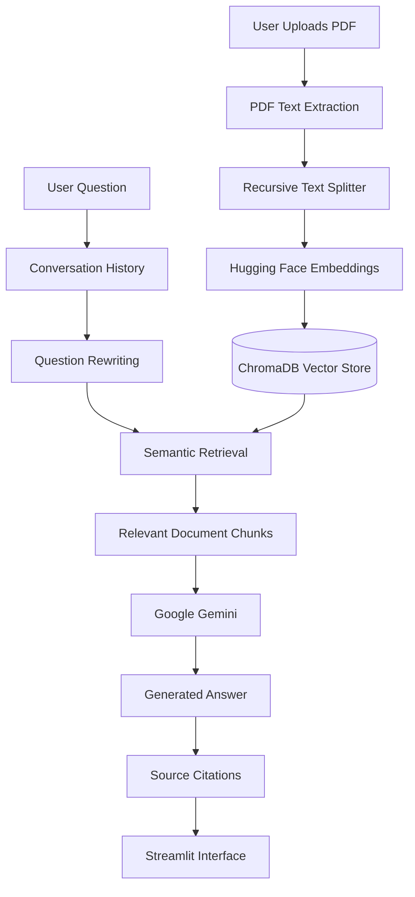
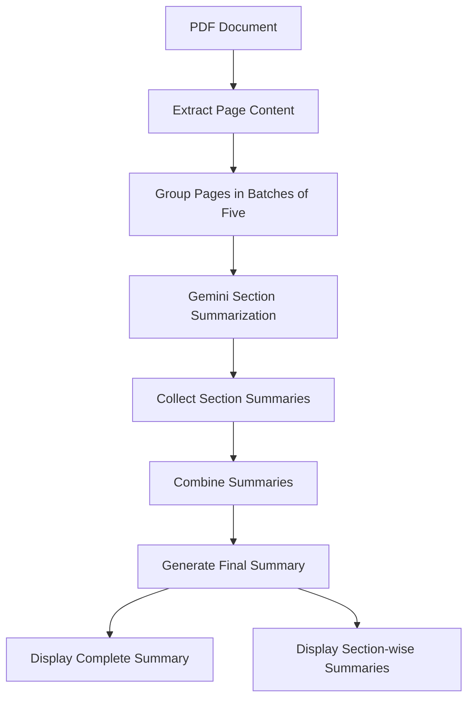

# 📚 DocuMind
### Turning Documents into Knowledge with AI

<p align="center">
  <b>An AI-powered PDF Question Answering and Document Intelligence Platform built using Retrieval-Augmented Generation (RAG).</b>
</p>

<p align="center">
  <a href="https://documinds.streamlit.app/">
    
  </a>
  <a href="https://github.com/devanshikhandelwal/DocuMind">
    
  </a>
</p>

<p align="center">
  
  
  
  
  
</p>

---

# 🌐 Experience DocuMind

**Live Application:** https://documinds.streamlit.app/

**GitHub Repository:** https://github.com/devanshikhandelwal/DocuMind

What if you could upload a lengthy PDF, ask it questions just like you would ask a person, and receive answers directly from the document, along with the relevant page references?

That is the idea behind **DocuMind**.

DocuMind is an AI-powered document intelligence application that transforms static PDF files into interactive knowledge sources. It allows users to upload documents, explore their content through natural-language conversations, retrieve relevant information, and generate comprehensive summaries.

Instead of manually searching through hundreds of pages, users can simply ask questions and let AI find the relevant information.

The application uses **Retrieval-Augmented Generation (RAG)** to combine semantic document retrieval with Google's Gemini language model. This helps ground generated answers in the actual content of uploaded documents.

DocuMind is designed to make working with lengthy documents more accessible, interactive, and efficient.

---

# 🎯 The Problem

Working with PDF documents can become difficult when the information is spread across multiple pages.

Students, researchers, professionals, and developers frequently work with documents containing large amounts of information.

Some common challenges include:

- Finding a particular piece of information in a lengthy PDF.
- Understanding complex technical documents.
- Extracting important points without reading every page.
- Creating summaries of lengthy documents.
- Remembering where a particular piece of information appeared.
- Asking follow-up questions without repeatedly searching the document.

Traditional PDF readers mainly provide keyword-based search and manual navigation.

General-purpose AI chatbots can answer questions, but without document retrieval, their responses may not be grounded in the specific PDF being studied.

**DocuMind addresses these challenges by connecting document retrieval with generative AI.**

---

# 💡 The Solution

DocuMind creates an intelligent document workspace where users can interact with their PDFs through natural language.

The application follows a RAG-based approach:

1. Extract text from uploaded PDF documents.
2. Divide the extracted content into smaller overlapping chunks.
3. Generate semantic embeddings for each chunk.
4. Store embeddings and document metadata in ChromaDB.
5. Retrieve relevant passages when a user asks a question.
6. Pass the retrieved context to Google Gemini.
7. Generate an answer grounded in the document.
8. Display source filenames, page numbers, and retrieved passages.

In addition to question answering, DocuMind includes a multi-stage summarization pipeline that generates section-wise summaries and combines them into a complete document summary.

---

# ✨ Features

## 📄 1. Multiple PDF Uploads

Users can upload multiple PDF documents through the Streamlit interface.

The application:

- Accepts PDF files.
- Extracts text from individual pages.
- Processes multiple uploaded documents.
- Preserves document filenames as source metadata.
- Tracks successfully processed documents.
- Displays workspace information, including the number of indexed documents and generated chunks.

## 🧩 2. Intelligent Text Chunking

Large documents are divided into smaller text chunks before embedding generation.

DocuMind uses LangChain's `RecursiveCharacterTextSplitter`.

**Current configuration:**

| Parameter | Value |
|---|---:|
| Chunk Size | 1000 characters |
| Chunk Overlap | 200 characters |
| Primary Purpose | Preserve context between chunks |

Overlapping chunks help retain contextual continuity when information spans multiple sections of a document.

## 🧠 3. Semantic Embedding Generation

DocuMind uses the Hugging Face Sentence Transformers model:

`sentence-transformers/all-MiniLM-L6-v2`

The embedding model converts text chunks into numerical vector representations.

These vectors allow the application to identify passages based on semantic similarity rather than relying only on exact keyword matches.

**Embedding configuration:**

- Model: all-MiniLM-L6-v2
- Execution: CPU
- Embedding normalization: Enabled

## 🗄️ 4. Persistent Vector Storage

DocuMind uses ChromaDB as its vector database.

The database stores:

- Document chunk embeddings.
- Extracted text chunks.
- Source filenames.
- Original page metadata.

This allows the application to perform semantic similarity searches and retrieve relevant document passages.

## 🔍 5. Semantic Document Retrieval

When a user submits a question, DocuMind searches the vector database for relevant document chunks.

The retriever supports:

- Similarity-based document retrieval.
- Retrieval of the top relevant chunks.
- Filtering by document filename.
- Page-specific retrieval when a page is requested.
- Combined document and page filtering.

This helps ensure that the answer is generated using relevant content from the selected document.

## 🤖 6. AI-Powered Question Answering

Google Gemini powers DocuMind's question-answering functionality.

The application passes the retrieved document context and user question to the Gemini model.

The model generates responses using the available document information.

The system prompt emphasizes:

- Answering from the provided document context.
- Avoiding unsupported claims.
- Preserving important facts and technical details.
- Clearly distinguishing explicit document information from inferred information.
- Identifying illustrative examples appropriately.

## 📚 7. Source Citations and Page References

Transparency is an important part of document-based AI systems.

DocuMind displays source information alongside generated answers.

Users can inspect:

- The source PDF filename.
- The relevant page number.
- A preview of the retrieved text passage.

This makes it easier to verify where an answer came from.

## 💬 8. Conversational Memory

DocuMind supports follow-up questions by using recent conversation history.

For example:

- User: What is machine learning?
- User: Explain its types.
- User: Give me an example of the second type.

The application can rewrite follow-up questions into more self-contained queries before performing retrieval.

This helps the retrieval system understand the context of a conversation rather than treating every question as completely independent.

## 🎯 9. Document-Specific Retrieval

When multiple PDFs are uploaded, users can select a particular document.

The retriever applies source metadata filtering so that questions can be answered using the selected PDF rather than mixing content from unrelated documents.

## 📖 10. Full Document Summarization

DocuMind includes a dedicated full-document summarization pipeline.

Instead of sending an entire lengthy PDF in a single request, the application divides the extracted pages into smaller groups.

**Current summarization workflow:**

1. Extract text from PDF pages.
2. Divide pages into groups of five.
3. Generate a summary for each group using Gemini.
4. Collect the individual section summaries.
5. Combine the summaries into a single final summary.
6. Display the complete summary and section-wise results.

The output includes:

- A complete document summary.
- Individual section summaries.
- Page ranges covered by each section.
- A total count of text-containing pages.

This approach makes lengthy documents easier to understand and review.

---

# 🏗️ System Architecture

DocuMind consists of two major workflows:

1. Document ingestion and indexing.
2. Retrieval-Augmented Generation and response generation.

## 1. RAG Architecture



## 2. Document Summarization Architecture



---

# ⚙️ Technology Stack

| Technology | Purpose |
|---|---|
| Python | Core application development |
| Streamlit | Interactive frontend and application interface |
| Google Gemini | AI-powered question answering and summarization |
| Retrieval-Augmented Generation | Ground document-based responses in retrieved content |
| Hugging Face | Embedding model integration |
| Sentence Transformers | Semantic text embeddings |
| all-MiniLM-L6-v2 | Text embedding model |
| ChromaDB | Vector storage and similarity search |
| LangChain | Text splitting and embedding integrations |
| PyPDF | PDF text extraction |
| Python-dotenv | Local environment variable management |
| Pytest | Automated testing |
| Git and GitHub | Version control and source code management |
| Streamlit Community Cloud | Application deployment |

---

# 🧰 Project Structure

The project is organized into modular components to separate document processing, embedding generation, retrieval, and AI response generation.

```text
DocuMind/
│
├── app.py
│
├── requirements.txt
├── README.md
├── .gitignore
├── .env
│
├── src/
│   ├── __init__.py
│   ├── document_loader.py
│   ├── document_summarizer.py
│   ├── text_splitter.py
│   ├── embeddings.py
│   ├── vector_store.py
│   ├── retriever.py
│   └── qa_chain.py
│
├── tests/
│   ├── __init__.py
│   ├── test_document_loader.py
│   ├── test_document_summarizer.py
│   ├── test_embeddings.py
│   ├── test_qa_chain.py
│   ├── test_retriever.py
│   ├── test_text_splitter.py
│   └── test_vector_store.py
│
├── data/
│   └── uploaded_docs/
│
└── vector_db/
```

### Module Responsibilities

| File | Responsibility |
|---|---|
| `app.py` | Streamlit application, user interface, uploads, chat, and summarization |
| `document_loader.py` | PDF loading and page-wise text extraction |
| `text_splitter.py` | Splitting extracted text into overlapping chunks |
| `embeddings.py` | Hugging Face embedding model initialization |
| `vector_store.py` | ChromaDB creation and loading |
| `retriever.py` | Semantic search and metadata-based filtering |
| `qa_chain.py` | Question rewriting, retrieval, Gemini response generation, and source handling |
| `document_summarizer.py` | Multi-stage PDF summarization |
| `tests/` | Automated tests for the major components |

Runtime folders such as `vector_db/` and `data/uploaded_docs/` are not intended to be committed as project source data.

---

# 🔄 Detailed Implementation

## Document Loading

The document loader uses PyPDF to read individual PDF pages.

For every page containing extractable text, the application stores:

- Extracted page content.
- Original PDF filename.
- Physical page number.

This metadata is carried forward into subsequent processing stages.

## Text Splitting

The Recursive Character Text Splitter divides extracted content into smaller chunks.

The configured separators are:

- Paragraph breaks.
- Line breaks.
- Spaces.
- Individual characters as a fallback.

The chunk overlap helps preserve information across chunk boundaries.

## Embedding Generation

The Hugging Face embedding model transforms text chunks into vector representations.

Normalized embeddings are used for semantic similarity search.

## Vector Database

ChromaDB stores the generated embeddings and their associated document metadata.

The retriever can filter search results using document filenames and page numbers.

## Question Processing

The question-answering pipeline:

1. Validates the user's question.
2. Uses recent chat history to rewrite follow-up questions where necessary.
3. Detects page-specific requests.
4. Retrieves relevant chunks.
5. Constructs the document context.
6. Sends the context and question to Gemini.
7. Returns the generated answer and source information.

## Summarization Pipeline

The summarizer:

1. Loads the PDF.
2. Extracts text-containing pages.
3. Groups pages into batches of five.
4. Summarizes each group.
5. Combines the generated section summaries.
6. Generates a final summary.
7. Returns the summary, total text-containing page count, and section-wise results.

---

# 🚀 Getting Started

Want to run DocuMind on your own machine?

Follow the steps below.

## Prerequisites

Before installing the application, make sure you have:

- Python 3.12 or 3.13.
- Git installed.
- A Google Gemini API key.
- An internet connection for installing dependencies and downloading the embedding model.

## Step 1: Clone the Repository

```bash
git clone https://github.com/devanshikhandelwal/DocuMind.git
```

Navigate into the project directory:

```bash
cd DocuMind
```

## Step 2: Create a Virtual Environment

```bash
python -m venv venv
```

Activate the virtual environment.

**Windows:**

```powershell
venv\Scripts\activate
```

**macOS/Linux:**

```bash
source venv/bin/activate
```

## Step 3: Install Dependencies

```bash
pip install -r requirements.txt
```

## Step 4: Configure the Gemini API Key

Create a `.env` file in the project's root directory.

Add the following:

```env
GOOGLE_API_KEY=your_gemini_api_key
```

Obtain your API key from:

https://aistudio.google.com/

**Important:** Never commit your `.env` file or expose your API key in a public repository.

## Step 5: Launch DocuMind

Run the following command:

```bash
streamlit run app.py
```

The application will start locally and open in your default browser.

---

# 🧪 Testing and Validation

DocuMind includes an automated test suite implemented using Pytest.

Run all tests using:

```bash
pytest -v
```

### Components Tested

| Test Module | Testing Area |
|---|---|
| `test_document_loader.py` | Document loading |
| `test_text_splitter.py` | Text chunk generation |
| `test_embeddings.py` | Embedding generation |
| `test_vector_store.py` | Vector database creation |
| `test_retriever.py` | Document retrieval |
| `test_qa_chain.py` | Question answering |
| `test_document_summarizer.py` | Document summarization |

### Latest Recorded Test Result

```text
9 passed
```

The test suite validates the core functionality of the application's document processing, retrieval, and AI workflow components.

---

# ☁️ Deployment

DocuMind is deployed using **Streamlit Community Cloud**.

The deployed application is publicly accessible through the following URL:

### 🚀 https://documinds.streamlit.app/

The application uses Streamlit Secrets for secure Gemini API key configuration in the cloud environment.

Local development uses environment variables through `.env`.

This keeps API credentials separate from the publicly accessible source code.

---

# 🔐 Security and Configuration

A few important configuration practices are followed:

- API credentials are stored outside the application source code.
- `.env` is excluded from Git tracking through `.gitignore`.
- Streamlit Cloud Secrets are used for deployment credentials.
- Uploaded PDF files and the local vector database are excluded from version control.
- Application dependencies are maintained in `requirements.txt`.

---

# 💭 Engineering Decisions

Some of the important design decisions behind DocuMind include:

### Why RAG instead of sending an entire PDF directly to an LLM?

RAG allows the system to retrieve only relevant document passages before generating a response.

This reduces the amount of unrelated content passed to the language model and makes document-grounded question answering more practical.

### Why use ChromaDB?

ChromaDB provides vector storage and similarity search capabilities, making it suitable for retrieving semantically relevant document chunks.

### Why use overlapping chunks?

A piece of information may span multiple sentences or paragraphs. Overlap helps preserve context when the original document is divided into smaller sections.

### Why use page metadata?

Page metadata makes source attribution more useful because users can identify where retrieved information appeared in the original PDF.

### Why summarize documents in groups?

Dividing a lengthy document into smaller page groups keeps individual summarization requests manageable. Combining section summaries then produces a complete document overview.

---

# 🔮 Future Scope

DocuMind establishes a foundation for intelligent document interaction. There are several opportunities to expand it further.

Potential future enhancements include:

- **Multi-format document support:** Extend document processing to DOCX, TXT, and other formats.
- **Document Comparison:** Compare information across multiple uploaded PDFs.
- **Advanced Retrieval:** Explore reranking and hybrid search techniques to improve retrieval quality.
- **Downloadable Summaries:** Allow users to export generated summaries.
- **Evaluation Framework:** Measure retrieval relevance, answer faithfulness, and response quality.
- **Personalized Workspaces:** Introduce user authentication and individual document collections.
- **Improved Scalability:** Optimize document processing and vector database management for larger collections.

These are potential future improvements rather than features currently included in the deployed version.

---

# 👩‍💻 About the Developer

**Devanshi Khandelwal**

B.Tech – Artificial Intelligence & Machine Learning

I built DocuMind to explore how modern AI systems can be used to solve practical problems involving information retrieval and document understanding.

Working on this project involved implementing a complete RAG pipeline, integrating embeddings with a vector database, connecting a large language model, developing a multi-stage summarization workflow, writing automated tests, and deploying the application.

The project helped me gain practical experience with:

- Retrieval-Augmented Generation.
- Semantic search and vector embeddings.
- Large Language Model integration.
- Document processing and text chunking.
- Vector database operations.
- Prompt engineering and conversational context.
- Modular Python application development.
- Testing and cloud deployment.

### Connect With Me

- **GitHub:** https://github.com/devanshikhandelwal
- **LinkedIn:** https://linkedin.com/in/devanshi-khandelwal

---

# 🌟 Final Thoughts

DocuMind started with a simple question:

**What if interacting with a document could be as easy as having a conversation?**

That question became an opportunity to explore the practical side of Artificial Intelligence — not just using an existing AI model, but understanding how information is processed, represented, retrieved, and transformed into useful answers.

From extracting text out of PDFs to generating embeddings, building a vector database, implementing retrieval, connecting Gemini, and deploying a working application, DocuMind represents an end-to-end journey into building AI-powered software.

It is a step toward making information more accessible, reducing the effort required to understand lengthy documents, and turning static files into interactive knowledge.

This project is also a reminder that meaningful AI applications are not built around a model alone. They are built by bringing together data processing, retrieval, engineering decisions, testing, and thoughtful user experience.

**The goal was never just to build another chatbot. It was to make documents easier to understand.**

---

<p align="center">
  <b>📚 DocuMind — Your Documents. Your Knowledge. One Intelligent AI Assistant.</b>
</p>

<p align="center">
  <a href="https://documinds.streamlit.app/">
    
  </a>
</p>

<p align="center">
  Built with Python • RAG • Gemini AI • Hugging Face • ChromaDB
</p>